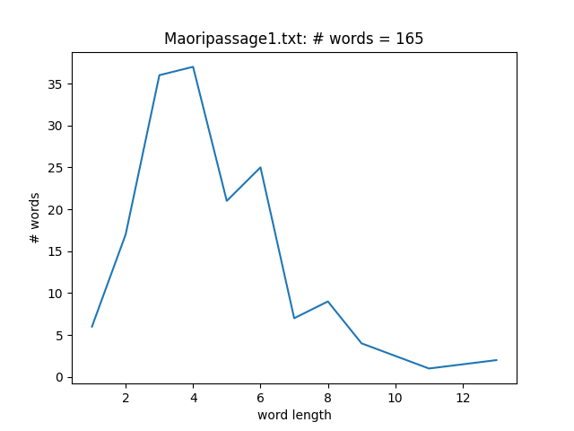
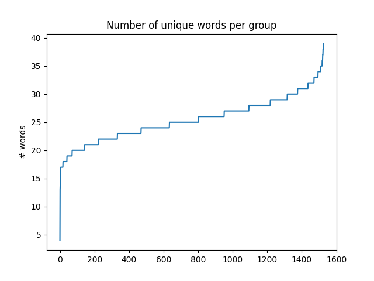
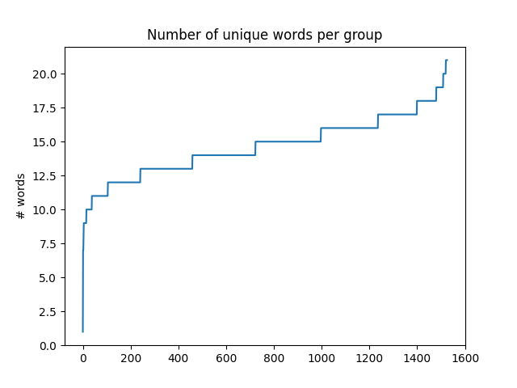
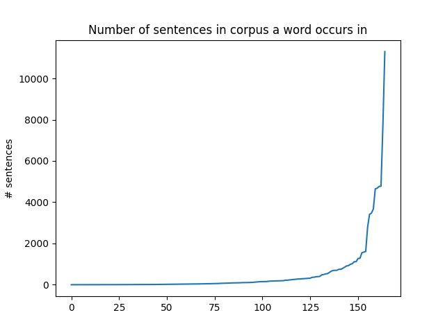
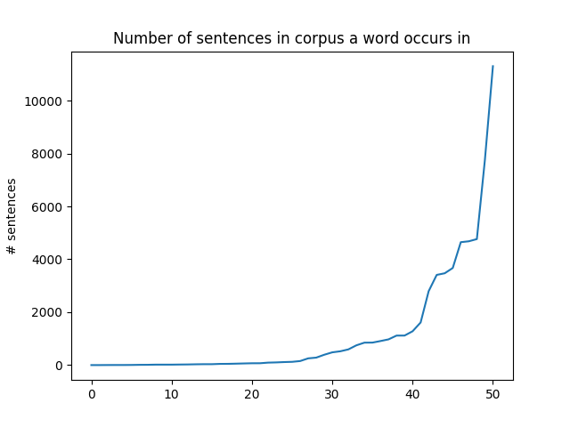
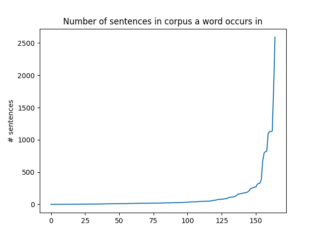
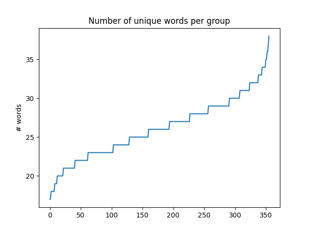

# Examples

## Information on corpus

```bash
info-corpus \
  -c "./test/Te Ara Copora grouped and numbered.txt"
```

Will output something like this:

```csv
name,value
# sentences,15251
# groups,1526
```


## Information on document

```bash
info-doc \
  -d "./test/Maoripassage1.txt"
```

Will output something like this:

```
name,value
# unique words,165
max word length,13
# words of length 1,6
# words of length 2,17
# words of length 3,36
# words of length 4,37
# words of length 5,21
# words of length 6,25
# words of length 7,7
# words of length 8,9
# words of length 9,4
# words of length 11,1
# words of length 13,2
```




## Per corpus group: count unique words from document that appear in group

### Maoripassage 1

```bash
check-groups \
  -c "./test/Te Ara Copora grouped and numbered.txt" \
  -d ./test/Maoripassage1.txt \
  -o ./test/output/Maoripassage1-groups.csv \
  -p \
  -P ./doc/img/Maoripassage1-groups.png
```




### Maoripassage 2

```bash
check-groups \
  -c "./test/Te Ara Copora grouped and numbered.txt" \
  -d ./test/Maoripassage2.txt \
  -o ./test/output/Maoripassage2-groups.csv \
  -p \
  -P ./doc/img/Maoripassage2-groups.png
```




## Per document word: count number of sentences it appears in

### Maoripassage 1

```bash
check-words \
  -c "./test/Te Ara Copora grouped and numbered.txt" \
  -d ./test/Maoripassage1.txt \
  -o ./test/output/Maoripassage1-words.csv \
  -p \
  -P ./doc/img/Maoripassage1-words.png
```




### Maoripassage 1

```bash
check-words \
  -c "./test/Te Ara Copora grouped and numbered.txt" \
  -d ./test/Maoripassage2.txt \
  -o ./test/output/Maoripassage2-words.csv \
  -p \
  -P ./doc/img/Maoripassage2-words.png
```




## Rare words

### Maoripassage 1

To ensure that rare words are included in recordings, you can create a sub-set 
of the corpus that covers rare words. 

The following generates a subset of the corpus with the following properties:

* a rare word must have at least 3 characters (`-m 3`)
* minimum number of groups the word must be occurring in (`-r 1`)
* maximum number of groups the word can occur in (`-R 25`)

```bash
rare-word-groups \
  -c "./test/Te Ara Copora grouped and numbered.txt" \
  -d ./test/Maoripassage1.txt \
  -m 3 \
  -r 1 \
  -R 25 \
  -o ./test/output/Maoripassage1-corpus-01to25.txt
```

Information about the corpus:

```bash
info-corpus \
  -c ./test/output/Maoripassage1-corpus-01to25.txt
```

Will output this:

```csv
name,value
# sentences,3560
# groups,356
```

The word distribution of this corpus subset can then be analyzed again:

```bash
check-words \
  -c "./output/Maoripassage1-corpus-01to25.txt" \
  -d ./test/Maoripassage1.txt \
  -o ./test/output/Maoripassage1-corpus-01to25-words.csv \
  -p \
  -P ./doc/img/Maoripassage1-corpus-01to25-words.png
```



```bash
check-groups \
  -c "./output/Maoripassage1-corpus-01to25.txt" \
  -d ./test/Maoripassage1.txt \
  -o ./test/output/Maoripassage1-corpus-01to25-groups.csv \
  -p \
  -P ./doc/img/Maoripassage1-corpus-01to25-groups.png
```




## Split corpus into subsets

### Random subsets of 100 groups each

The following command splits a corpus into subsets (with the same file format),
with each subset containing at most 100 groups (the last split contains the 
remainder). The order of groups is randomized before generating the splits,
using a seed value for reproducible outputs:

```bash
split-corpus \
  -c "./test/Te Ara Copora grouped and numbered.txt" \
  -r \
  -s 1 \
  -n 100 \
  -o "./test/output"
```


## Export corpus

The following exports all the sentences of the `Maoripassage1-corpus-01to25.txt`
corpus as separate text files (with the sentence ID as the file name, plus `.txt`
as extension) in the output directory `./output/sentences/`:

```bash
export-corpus \
  -c "./output/Maoripassage1-corpus-01to25.txt" \
  -o ./output/sentences/
```

Those sentence text files, alongside their `.wav` files can then be read with the
[audio-dataset-converter](https://github.com/waikato-llm/audio-dataset-converter/) 
using the [from-txt-sp](https://github.com/waikato-llm/audio-dataset-converter/blob/main/plugins/from-txt-sp.md)
reader and converted into other formats, e.g., 
[to-piper-sp](https://github.com/waikato-llm/audio-dataset-converter/blob/main/plugins/to-piper-sp.md).
